 

## 👩‍💻 About

**B.Tech Computer Science student** with a strong interest in technology and innovation. I enjoy working with **Python, Java** and web technologies (**HTML, CSS, JavaScript, Flask**) to build practical, real-world applications.

Currently, I am exploring **Generative AI** and continuously improving my **problem-solving** and **development** skills. I am a quick learner, adaptable, and passionate about building impactful solutions while growing as a developer. 🚀

> [!NOTE]
> **Open to opportunities** — Software Developer / Full-Stack Developer / Internship roles.

<table>
<tr>
<td valign="top" width="50%">

### 🛠️ Tech Stack

**Languages** 
 

**Frontend · Backend** 
 

**Databases** 
 

**Tools** 

</td>
<td valign="top" width="50%">

### 🎯 Current Focus

- ▸ Exploring **Generative AI**
- ▸ Solving DSA problems daily
- ▸ Strengthening Python, Java & JavaScript fundamentals
- ▸ Building real-world full-stack applications

</td>
</tr>
</table>

## 🚀 Projects

| Project | Description |
|---|---|
| 🛒 **Quick Cart** | Shopping web application with a smooth cart experience |
| 📚 **Continuous Learning Journey** | Tracks learning progress and growth over time |
| 🏥 **Medinearby** | Helps users find nearby medical facilities quickly |
| 🌪️ **Disaster Allocation System** | Resource allocation system for disaster situations |

*`// build . break . fix . repeat`*

